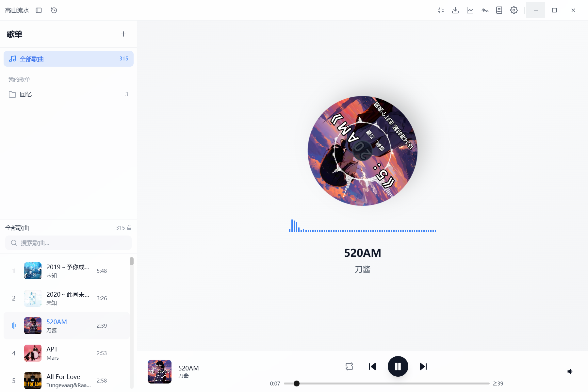

# 高山流水 · gaoshanliushui

> 让音乐回归音乐本身 —— 一款轻量、优雅、纯粹的本地音乐播放器。


高山流水是一款基于 **Tauri v2 + Vue 3** 的本地音乐播放器。它只播放你本机的 MP3 / MP4，
所有数据（歌曲索引、歌单、回忆、播放历史、设置）都保存在本地：**不登录、不上云、不做算法推荐、不收集任何数据**。

当前版本 **v1.3.0**，主要面向 Windows 10/11（依赖 WebView2）。



## 特性

- **本地曲库**：两阶段扫描 + 后台 ID3 解析，虚拟列表支撑 5000 首量级；支持「智能 / 仅文件名」两种元数据来源。
- **低内存播放引擎**：默认「流式播放」——按需读取压缩音频、边播边解码，不再把整首歌的 PCM 常驻内存；设置页可一键回退为整曲解码。
- **专业音频链路**：Web Audio API 统一链路，10 段均衡器（EQ）、实时响度均衡（RMS / EBU R128 LUFS）、频谱可视化。
- **歌单与回忆**：全部歌曲 / 自定义歌单 / 回忆，支持歌单导入导出；SQLite 单文件持久化。
- **播放历史与统计**：去重展示历史、完整历史、今日/本月/本年/全部统计，可导出 Markdown。
- **系统集成**：关闭到托盘、托盘隐藏时 WebView2 内存目标降级、开机自启、全局快捷键、MediaSession / Windows SMTC 媒体键、迷你模式、睡眠定时器。
- **可定制外观**：浅色 / 深色 / 跟随系统、自定义字体、单图 / 轮播背景、毛玻璃效果、无边框窗口。
- **可选扩展**：B 站音乐下载（内置 ffmpeg sidecar）。
- **隐私优先**：不联网也能完整使用；数据从不离开本机。


## 性能

以下数据均来自同机、release 构建的实测（Windows 11 / WebView2 155 / 32GB），口径见
[性能预算](markdown/性能/性能预算.md)。流式播放与整曲解码为同一构建内 A/B 对比。

| 指标 | 实测 |
| --- | --- |
| 启动 | 窗口创建 181ms，app-ready 169ms |
| 列表滚动 | 60 FPS，P95 帧 17ms，卡顿帧 0，长任务 0 |
| 切歌延迟（流式，默认） | 中位 61~90ms，P95 71~179ms（预算 < 200ms） |
| 切歌延迟（整曲解码，回退） | 中位 15ms，P95 33~37ms |
| 播放稳态内存（私有工作集） | 流式 165~223MB / 整曲 283~305MB |
| 切歌峰值内存（私有工作集） | 流式 359~381MB / 整曲 643~655MB（流式 **−44%**） |
| 托盘隐藏后台播放 | 约 50~130MB（任务管理器应用行读数，随工作集修剪波动） |
| 体积 | 主入口 Gzip 30.43KB；JS 合计 141.14KB；二进制 8.27MB；NSIS 安装包 28.97MB |
| 质量 | 前端 104 个单测 + Rust 57 个单测；ESLint 0 error；体积门禁全部 PASS |

> 完整的性能记录（P0~P4：切歌分段、滚动内存、主入口瘦身、双口径预算、托盘降级、流式播放）见
> [性能记录目录](markdown/性能/记录)。

## 技术栈

| 层 | 选型 |
| --- | --- |
| 桌面壳 | Tauri v2（Rust） |
| 前端 | Vue 3 + Composition API + TypeScript |
| 构建 | Vite 6 |
| 状态 | Pinia（按领域拆分 store） |
| 样式 | Tailwind CSS 3.4 |
| 音频 | Web Audio API + 流式 `<audio>`（默认）/ AudioBufferSourceNode（回退） |
| 数据库 | SQLite（rusqlite，单文件） |
| 持久化 | LocalStorage（设置类轻量配置） |
| 工具链 | ESLint / Prettier / Vitest / vue-tsc / cargo fmt / clippy |

## 快速开始

### 环境要求

- Node.js **22+**、npm
- Rust **stable**（含 cargo）
- Windows 10/11（WebView2 Runtime）；其他 Tauri 依赖见 [Tauri 前置条件](https://tauri.app/start/prerequisites/)

### 开发

```bash
# 安装前端依赖
npm install

# 桌面开发（Vite HMR + Rust 热重载）
npm run tauri dev

# 仅浏览器预览前端（无原生能力，仅调试 UI）
npm run dev
```

### 构建

```bash
# 完整打包：前端构建 + Rust release + NSIS 安装包
npm run tauri build
```

产物位置：

- 可执行文件：`src-tauri/target/release/gaoshanliushui.exe`
- 安装包：`src-tauri/target/release/bundle/nsis/高山流水_<版本>_x64-setup.exe`

> 仓库内已包含 B 站下载所需的 ffmpeg sidecar（`src-tauri/binaries/`），首次 clone 体积约 100MB；
> 如果不需要下载功能，可在本地删除该文件并把 `src-tauri/tauri.conf.json` 的 `externalBin` 一并去掉。

### 质量与性能命令

```bash
npm run typecheck     # vue-tsc 类型检查
npm test              # Vitest 单测
npm run lint          # ESLint
npm run format:check  # Prettier 检查
npm run perf:gate     # 体积预算门禁（主入口 / JS 合计 / 安装包等）
npm run perf:snapshot # 生成性能快照
npm run perf:runtime  # 运行期内存 / 帧率 / 切歌实测（需先构建 release）
```

Rust 侧：

```bash
cargo fmt --manifest-path src-tauri/Cargo.toml --check
cargo clippy --manifest-path src-tauri/Cargo.toml --all-targets -- -D warnings
cargo test --manifest-path src-tauri/Cargo.toml
```

CI（`.github/workflows/ci.yml`）在 push / PR 时执行上述前端检查（含体积门禁）与 Windows Rust 检查。

## 目录结构

```text
├── src/                  前端源码
│   ├── audio/            播放引擎（流式 / 整曲解码 / EQ / 响度 / 缓存）
│   ├── components/       UI 组件（播放器、列表、设置、抽屉等）
│   ├── stores/           Pinia 领域 store（audio / library / history / settings / ui / memory）
│   └── utils/            工具函数（存储、队列、格式化、性能记录）
├── src-tauri/            Rust 后端
│   ├── src/commands/     命令（曲库、歌单、历史、回忆、托盘、下载、WebView2 内存…）
│   ├── src/db.rs         SQLite 初始化与迁移
│   └── binaries/         ffmpeg sidecar（B 站下载用）
├── assets/screenshots/   README 截图
├── scripts/              性能测量、体积门禁、快照脚本
├── markdown/             项目文档（介绍 / 方案 / 性能 / 汇报 / 调研 / 杂项）
└── .github/workflows/    CI
```

## 文档

完整索引见 [markdown/README.md](markdown/README.md)。常用入口：

| 文档 | 说明 |
| --- | --- |
| [项目介绍](markdown/介绍/项目介绍.md) | 设计哲学、架构与功能总览 |
| [性能预算](markdown/性能/性能预算.md) | 双口径内存、切歌/帧率/体积预算（唯一口径来源） |
| [综合性能测试报告 v1.3.0](markdown/性能/综合性能测试报告-v1.3.0.md) | 启动、内存、CPU、列表、音频、Bundle 等评估 |
| [性能测试方案与记录规范](markdown/性能/性能测试方案与记录规范.md) | 测量口径、工具用法与数据落盘规范 |
| [后续优化方向](markdown/性能/后续优化方向-P0-P3.md) | P0~P4 路线、执行状态与交接说明 |
| [优化方案](markdown/方案/优化方案.md) | 历史优化项与实施记录 |

## 数据与隐私

- 数据库：Windows 下 `%APPDATA%\com.gaoshanliushui.player\memories.db`（歌曲、歌单、回忆、播放历史）。
- 设置：LocalStorage（主题、字体、背景、音量、循环模式、流式播放开关等）。
- 网络：正常使用不需要网络；仅「B 站音乐下载」会访问网络，且下载内容只写入本地。
- 遥测：无。没有账号、没有云端、没有第三方统计。

## 常见问题

**支持哪些格式？**
当前以 MP3 / MP4 为主；扫描与 ID3 解析针对本地文件，其他格式是否可播取决于 WebView2 的解码支持。

**托盘里的内存为什么一首歌涨一点？**
流式播放的 Blob 缓存上限为 8 首 / 96MB，前几首会逐步填满；同时每首歌的封面与媒体解码缓冲会占用一部分工作集，
隐藏窗口时 Chromium 的 GC 较懒，任务管理器读数会呈「涨一点、修剪回落」的锯齿，属正常现象，不是泄漏
（详见 [流式播放实现记录](markdown/性能/记录/2026-10-18-流式播放实现-01.md)）。

**切歌感觉比之前慢了一点？**
默认的流式播放每次换源需要媒体管线重新初始化，命中路径比整曲解码多约 50ms；
如果更在意切歌速度，可在「设置 → 系统 → 流式播放（省内存）」关闭，回到整曲解码模式。

**为什么不做在线音乐 / 登录 / 云同步？**
这是有意为之的产品边界：只做本地、纯粹、可离线使用的播放器。

## 许可

[MIT](LICENSE)

## 致谢

- [Tauri](https://tauri.app/)：轻量跨平台桌面壳
- [Vue](https://vuejs.org/) / [Pinia](https://pinia.vuejs.org/) / [Vite](https://vite.dev/) / [Tailwind CSS](https://tailwindcss.com/)
- [ffmpeg](https://ffmpeg.org/)：B 站音乐下载的转码与合流
- 以及所有为本项目提供灵感与反馈的朋友
